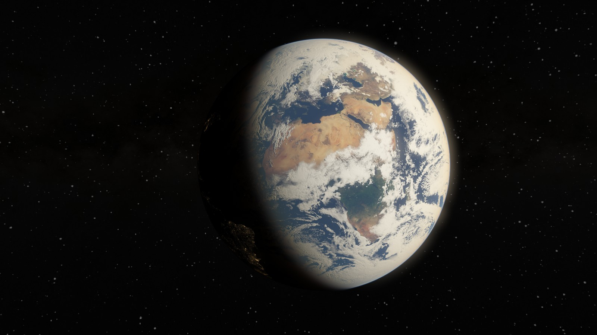

# Voltura Worlds

**Your desktop, alive.** Native animated worlds for Windows 11.

[Product site](https://worlds.voltura.se/) · [Releases](https://github.com/voltura/voltura-worlds/releases) · [Using Worlds](docs/USING.md)



## Worlds and desktop controls

Choose from **22 built-in Worlds**, independently on each display:

- **Moving artwork:** Aurora, Orbit, Smoke, Bloom, Silk, Eclipse, Lattice, Drift, Contour, Plastic metal and Ripples.
- **Solar System:** Mercury, Venus, Earth, Mars, Jupiter, Saturn, Uranus, Neptune, Moon, Pluto and Sun.

Each World has palettes, brightness and movement controls, scene-specific adjustments and optional Gentle or Expressive audio reaction. Playback analysis stays on your PC; audio is not recorded or uploaded. Solar System scenes combine observational imagery and artistic rendering; [source notices](THIRD-PARTY-NOTICES.md) explain their limits.

- **Random** shuffles all built-in Worlds; **Random Solar System** shuffles the eleven bodies. Each display saves its interval and pauses the countdown with playback.
- **Show body statistics** adds optional facts in the lower-right corner of Solar System Worlds.
- **Adjustments** contains artwork, audio, video and display settings. **Apply to all displays** copies the selected configuration.
- **Quality** and **Frame limit** are saved per display, with adaptive cadence and supported detail adjustment in Auto. Displays on the same GPU share immutable artwork and pipelines.
- **Output: Auto** uses HDR for built-in Worlds when Windows HDR is enabled and supported; **SDR** keeps SDR output. Worlds does not change Windows display settings.
- **Import video…** accepts personal SDR videos supported by installed Windows decoders. H.264 MP4 is the baseline; Fill/Fit, crop positioning and 0.25x–2x playback speed are available. Playback loops silently.
- **Presets…** saves named whole-desktop configurations and exports portable `.world` packages with required videos and reviewed display mapping.
- Playback pauses on battery by default, for fully covered displays, lock, sleep and remote sessions. **Off** reveals your Windows wallpaper; **Exit Worlds** stops the app. Closing the library keeps it running.

See [Using Worlds](docs/USING.md) for the full guide and [documentation](docs/README.md) for technical references.

## Current release

**Version 0.1.10** is available. [Download the Windows installer](https://github.com/voltura/voltura-worlds/releases/download/v0.1.10/VolturaWorlds-Setup-0.1.10-win-x64.exe) from [Releases](https://github.com/voltura/voltura-worlds/releases/tag/v0.1.10). Includes all **22 Worlds** and personal MP4 video wallpapers. Setup requires no administrator access. GitHub's source ZIP does not contain a built app.

Pluto includes the original New Horizons heart region and artistically reconstructed far-side and southern terrain. Reconstructed detail is not additional spacecraft measurement. See [Pluto sources and limitations](assets/pluto/ATTRIBUTION.md).

Run the installer to upgrade. Existing settings, imported videos and startup preferences are retained.

Enable **Automatic updates** in the notification-area menu to download verified future releases in the background. Updates install on **Exit Worlds**; **Restart to update** appears when a download is ready. See [automatic updates](docs/UPDATES.md) for verification and behavior.

## Build and run

Requires Windows 11 x64, Visual Studio 2026 C++ desktop tools, the Windows SDK, PowerShell and Python 3.12 or newer with pip. NSIS is needed for packaging. The bootstrap script downloads and checks the native dependencies; install the Python test and media tools before building.

```powershell
git clone https://github.com/voltura/voltura-worlds.git
cd voltura-worlds
python -m pip install -r requirements-dev.txt
./scripts/build.ps1
./build/Release/VolturaWorlds.exe
```

The build script runs CTest after compilation. To produce a per-user installer:

```powershell
./scripts/package.ps1 -SkipBuild
```

Packaging does not run the installer. See [Using Worlds](docs/USING.md) for installation, local settings, playback and signing details. Closing the library keeps Worlds running; use **Exit Worlds** in the tray menu to quit.

## Product site

The independent, buildless product site lives in [`site/`](site/). It has no external fonts, tracking or runtime dependencies. GitHub Pages publishes it from the `gh-pages` branch at [worlds.voltura.se](https://worlds.voltura.se/).

See [website maintenance](docs/PAGES.md) for local preview, native media capture and publication.

## License and credits

[MIT](LICENSE), copyright © 2026 Voltura AB. Third-party dependencies and artwork retain their [own licenses and credits](THIRD-PARTY-NOTICES.md), including [Orbit's source imagery](assets/orbit/ATTRIBUTION.md).
